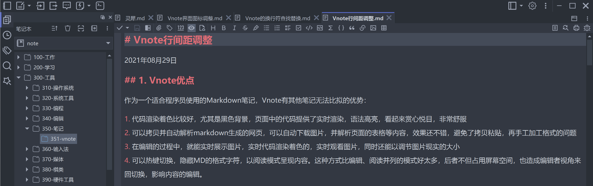

# VNote
  

VNote-refine定制版本主要改动：

Vnote配置数据的两个文件夹缺省保存在应用程序当前目录下。

1. 编辑器的文本之间的行间距拉大，并可配置调整，空白行则不作拉大。 文本行间距，缺省为0.5；代码行间距，缺省为0.2。

1. 快速创建笔记，缺省创建笔记并打开，关闭时自动提醒重命名笔记。 工具栏图标按钮、Ctrl+N、tab空白处双击、无笔记打开时双击背景都可快速创建并打开。 原有模式保留，可通过热键Ctrl+Alt+N激活，选择模板来创建笔记。

1. 当前tab页的笔记文件名加粗体字体显示，其他tab页正常字体。 存在分割窗口的时候，不同窗口内的笔记文件名均加粗，不在当前窗口内的斜体显示。

1. 回车换行的查找替换功能。 正则表达式模式下，支持\n代表的回车换行符的查找和替换。

1. 部分防盗链网页图片下载功能。 在文档头部手工填写referer信息，例如：@@https://cloud.tencent.com/，再拷贝图片链接，即可下载相关图片。

1. 修正快捷键在中文输入法状态下的问题 中文输入法，输入前导键之后，允许字母热键输入。修正片段插入、界面导航存在的小问题。

1. Vnote界面图标和界面的微调。 基于开源免费svg调整了界面图标。

1. Vnote编辑模式下，光标之外的文本块自动隐藏markdown语法标记。

[简体中文](README_zh_CN.md)

[Project on Gitee](https://gitee.com/vnotex/vnote)

A pleasant note-taking platform.

For more information, please visit [**VNote's Home Page**](https://docs.vnote.fun).

## Description
**VNote** is a Qt-based, free and open source note-taking application. It combines note management with an excellent editing experience across multiple document formats.

VNote runs on **Linux**, **Windows**, and **macOS**, and requires **Qt 6.9+**. Qt 5.15 and Windows 7 are no longer supported.

### Supported formats
**VNote is more than a Markdown editor — these formats are supported today:**

* **Markdown** (`.md`, `.mkd`, `.rmd`, `.markdown`): write, edit, and preview Markdown notes
* **Typst** (`.typst`): write and edit typeset documents with the native Typst editor and live PDF preview
* **Plain text and source code** (`.txt`, `.log`, `.py`, `.cpp`, `.js`, `.json`, `.yaml`, and more): edit text notes, logs, code, and configuration files
* **Mind maps** (`.mmm`, `.emind`): create and edit mind maps with the native mind-map editor
* **PDF** (`.pdf`): read PDF documents with the built-in viewer

## Downloads
Continuous builds on `master` branch could be found at the [Continuous Build](https://github.com/vnotex/vnote/releases/tag/continuous-build) release.

Latest stable builds could be found at the [latest release](https://github.com/vnotex/vnote/releases/latest) or [Gitee release](https://gitee.com/vnotex/vnote/releases)

## Supports
* [GitHub Issues](https://github.com/vnotex/vnote/issues);
* Email: `tamlokx at gmail.com`;

Thank [users who donated to VNote](https://github.com/vnotex/vnote/wiki/Donate-List)!

## Development

See the [development guide](docs/development.md) for prerequisites, setup, and build instructions.

## License
VNote is licensed under [GNU LGPLv3](https://opensource.org/licenses/LGPL-3.0).

Bundled third-party material and the notices its licenses require — the Lucide
(ISC/MIT) and IconPark (Apache-2.0) icon sets — are recorded in
[THIRD-PARTY-NOTICES.md](THIRD-PARTY-NOTICES.md).
